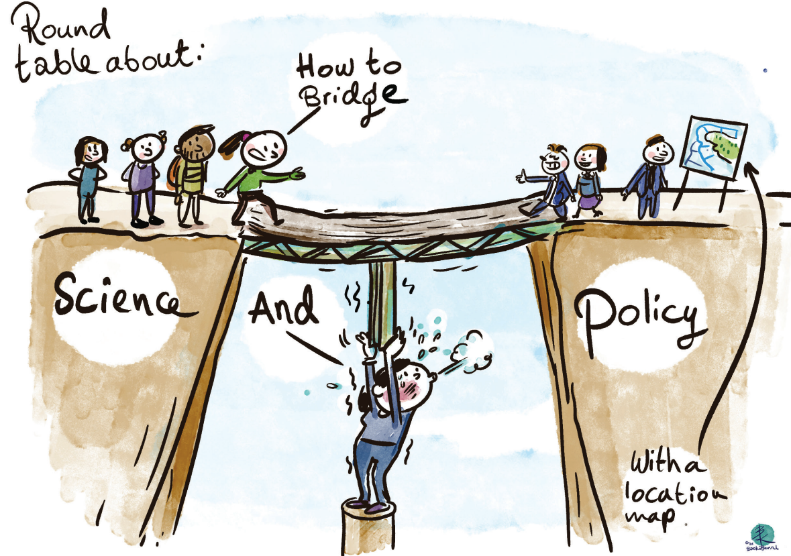
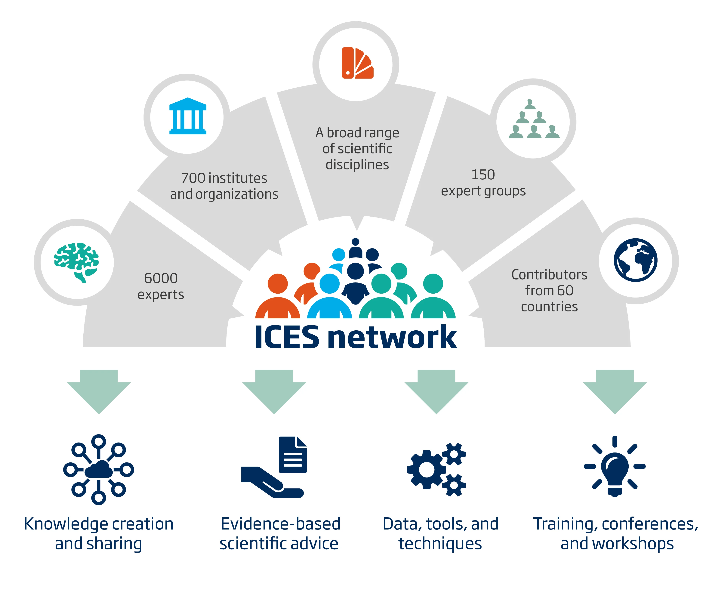
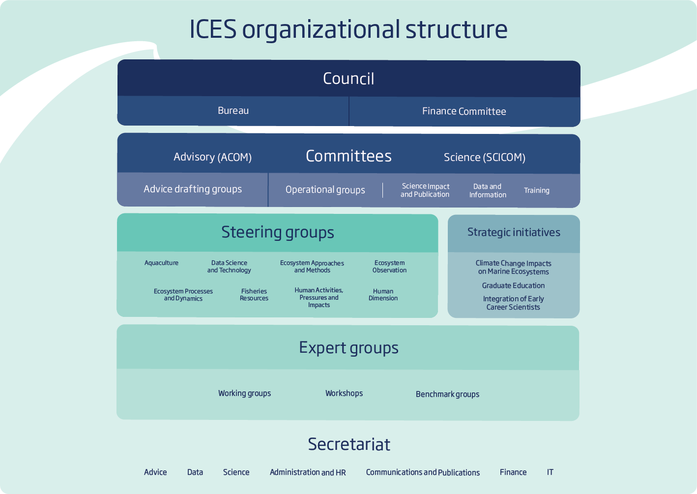
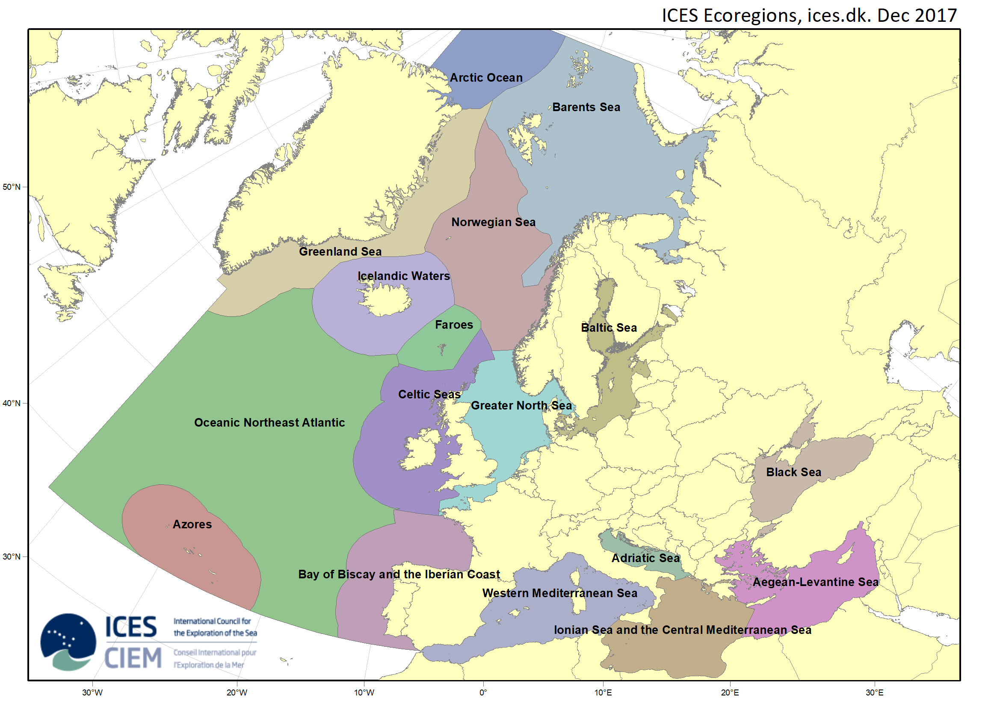
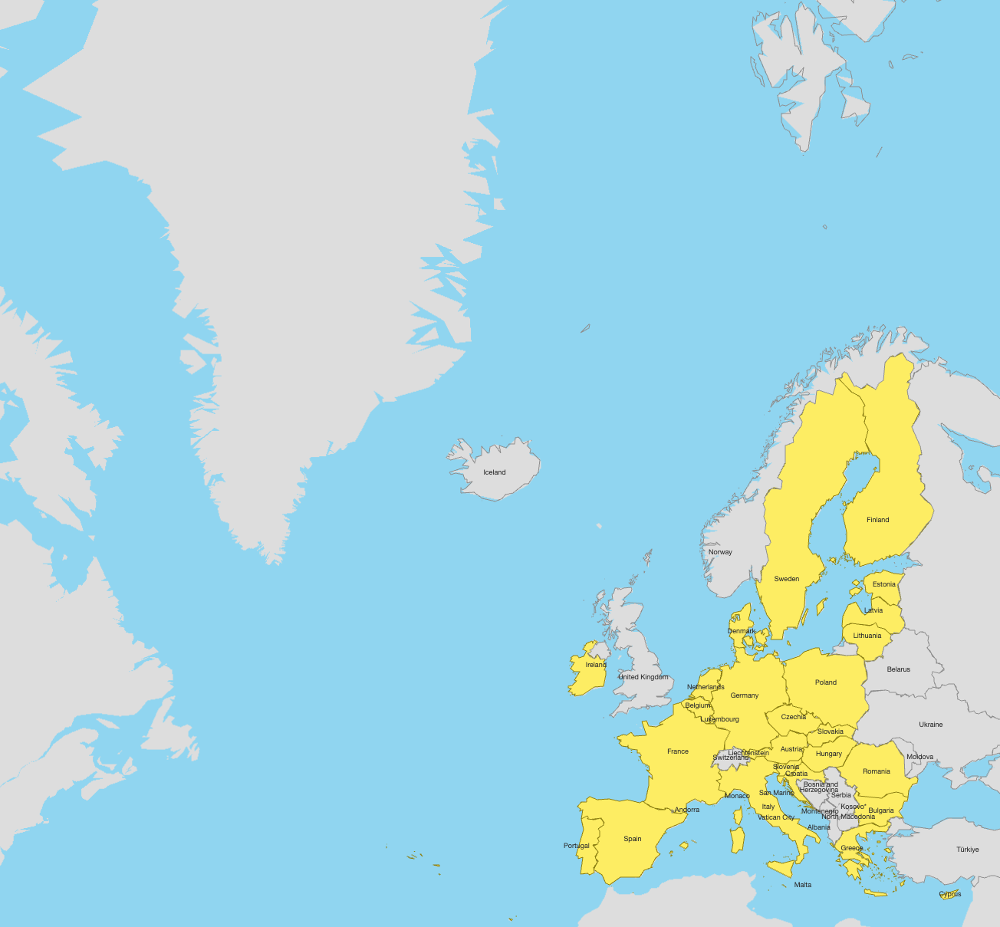

class: top, left

```{r setup, include=FALSE}

options(htmltools.dir.version = FALSE)
knitr::opts_chunk$set(echo = F,
                      fig.retina = 3,
                      warning = F,
                      message = F)
#Plotting and data libraries
library(tidyverse)
library(tidyr)
library(ggrepel)
library(here)

```

```{r, load_refs, include=FALSE, cache=FALSE}
library(RefManageR)
BibOptions(check.entries = FALSE,
           bib.style = "authoryear",
           cite.style = "authoryear",
           longnamesfirst = FALSE,
           max.names = 1,
           style = "markdown")
myBib <- ReadBib("./DeepUncertaintyMSE.bib", check = FALSE)

#,
#           hyperlink = FALSE,
#           dashed = FALSE

```

.pull-left-40[
## Overview of lecture

Briefly review US and northern Europe
*  Who manages fisheries?
*  Who provides scientific advice?

What is the International Council for the Exploration of the Seas ([ICES](https://www.ices.dk/Pages/default.aspx))?

What is the ICES advice framework?

How is ICES management advice evolving?



]

--


.pull-right-60[
## Regional Fisheries Management Organizations (RFMOs)

Tuna and highly migratory focus: 
*  International Commission for the Conservation of Atlantic Tunas ([ICCAT](https://www.iccat.int/en/)) 
*  Inter-American Tropical Tuna Commission ([IATTC](https://www.iattc.org/)) 
*  Western and Central Pacific Fisheries Commission ([WCPFC](https://www.wcpfc.int/))

Salmon focus:
*  North Atlantic Salmon Conservation Organization ([NASCO](https://nasco.int/))
*  North Pacific Anadromous Fish Commission ([NPAFC](https://www.npafc.org/))

Regional ecosystem focus:
*  Northwest Atlantic Fisheries Organization ([NAFO](https://www.nafo.int/About-us))
*  Commission for the Conservation of Antarctic Marine Living Resources ([CCAMLR](https://www.ccamlr.org/))

And many others that I won't be talking about

.footnote[
Sources: (left) [ICES ASC 2026 Bas Kohler Cartoons](https://www.ices.dk/events/Documents/ICES%20ASC%202026-BasKohler%20cartoons.pdf).  (right) [NOAA](https://www.fisheries.noaa.gov/international-affairs/international-and-regional-fisheries-management-organizations) and [US Dept of State Archive](https://2021-2025.state.gov/key-topics-office-of-marine-conservation/international-fisheries-management/)

]
]

---
## Fishery management in the US: participatory regional process

Eight regional Fishery Management Councils establish plans for sustainable management of stocks within their jurisdictions. All are governed by the same law, but tailor management to their regional stakeholder needs.  
.center[

]

More information: http://www.fisherycouncils.org/  
https://www.fisheries.noaa.gov/topic/laws-policies#magnuson-stevens-act

---
## Main concepts  `r Citep(myBib, "dicosimo_use_2010", "methot_implementing_2014")`
.pull-left-40[
MSY: *the largest long-term average catch or yield that can be taken from a stock or stock complex**  

Overfishing 
- *too much fishing mortality*
- $F > F_{MSY}$

Overfished 
- *too little biomass*
- $B < \frac12 B_{MSY}$

Rebuilding
- *grow overfished stock back*
- $B = B_{MSY}$


]
.pull-right-60[
```{r stock-status, warning=F, fig.width=8, fig.asp=0.7}
#fig.cap = paste0("Mid-Atlantic Fishery Management Council stock status"),
a <- ecodata::plot_stock_status(report = "MidAtlantic")

a$p + ggplot2::coord_cartesian(xlim=c(0,2), ylim=c(0,2)) +
  ggplot2::theme(text = ggplot2::element_text(size = 20)) +
  ggplot2::ggtitle("") +
  ggplot2::theme(legend.position = "none") #+
#  ggplot2::annotation_custom(gridExtra::tableGrob(a$unknown,
#                             theme = gridExtra::ttheme_default(base_size = 10), 
#                             rows=NULL), 
#                             xmin=0.8, xmax=1.8, ymin=1.5, ymax=2)
```
.center[Mid-Atlantic Fishery Management Council stock status]
]

<p style="color:#FF8C00;">*<i>under prevailing ecological, environmental conditions and fishery technological characteristics (e.g., gear selectivity), and the distribution of catch among fleets.</i></p>


---
background-image: url("https://github.com/sgaichas/presentations/raw/main/docs/EDAB_images/OFLABCACLetc.png")
background-position: left

## Getting to the quota
.right[
SSC = Scientific and  
Statistical Committee

MFMT = Maximum Fishing  
Mortality Threshold,  
typically $F_{MSY}$


**Councils have different methods**

**But all use F buffers**
]

---
## "In both constant F and ramped F control rules, precautionary buffers are used to reduce the OFL to the ABC to protect against scientific uncertainty." `r Citep(myBib, "free_harvest_2023")` Fig. 2

.center[

]

---
## Where does the science come from?

.pull-left[
Mainly NOAA/NMFS Science Centers in the US


.footnote[
More info: https://www.fisheries.noaa.gov/contact-directory/science-centers
]
]

--


.pull-right[
Mainly ICES in Northern Europe, via national labs


.footnote[
Source: https://www.ices.dk/about-ICES/who-we-are/Pages/Who-we-are.aspx
]
]


---
## What is the International Council for the Exploration of the Seas (ICES)?

.pull-left-30[ 
ICES is an intergovernmental organization with 19 Member Countries: 
.table[ 
*  Belgium
*  Canada
*  Denmark
*  Estonia
*  Finland
*  France
*  Germany
*  Iceland
*  Ireland
*  Latvia
*  Lithuania
*  The Netherlands
*  Norway
*  Poland
*  Portugal
*  Spain
*  Sweden
*  United Kingdom
*  United States of America
]
]

.pull-right-70[

]


---
## Fishery management in Europe: multiple jurisdictions and legal frameworks

.pull-left-70[
Ecoregions

]

--

.pull-right-30[
European Union (yellow) 

ICES Member States (orange)

]


---
.pull-left[
## European Common Fisheries Policy (CFP)


]

.pull-right[
## UK

## Norway

## Iceland

]

---
background-image: url(https://github.com/sgaichas/HSpresentations/raw/main/docs/images/Advisory_framework_text.jpg)
background-size: 700px
background-position: bottom 130px left 30px

## ICES Advice Process: Framework and Principles

.pull-left-60[

.footnote[
Sources: https://www.ices.dk/about-ICES/how-we-work/Pages/Advisory_process.aspx   
ICES (2025). Advisory Plan. ICES Convention, policies, and strategy. Report. https://doi.org/10.17895/ices.pub.28238150.v1  
ICES (2025). Guidelines for ICES advisory process. Version 1. ICES Guidelines and Policies - Advice Technical Guidelines. 29 pp. https://doi.org/10.17895/ices.pub.30885011 
]
]

--

.pull-right-40[

]


---
background-image: url(https://github.com/sgaichas/HSpresentations/raw/main/docs/images/ICESadviceproduction.png), url(https://github.com/sgaichas/HSpresentations/raw/main/docs/images/ICESadviceproducts.png)
background-size: 600px, 550px
background-position: bottom 80px left 20px, bottom 70px right 20px

## ICES Advice: Production and Products

.footnote[
Source: ICES (2025). Advisory Plan. ICES Convention, policies, and strategy. Report. https://doi.org/10.17895/ices.pub.28238150.v1
]

---
background-image: url(https://github.com/sgaichas/HSpresentations/raw/main/docs/images/ICES_assessment_adviceloop.png)
background-size: 900px
background-position: bottom 30px right 10px

## ICES Assessments and Fishing Opportunity Advice


---
## ICES Reference Points and Advice Rule(s)

---
## Examples

---
## How is ICES Advice Evolving?


---
background-image: url(https://github.com/sgaichas/HSpresentations/raw/main/docs/images/ICESthankyougreen.png)
background-size: cover
background-position: center

class: middle

Slides available at https://sgaichas.github.io/HSpresentations/  
Contact: <sgaichas@hydrascientificllc.com> and <sarah.gaichas@ices.dk>


