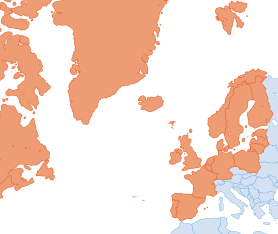
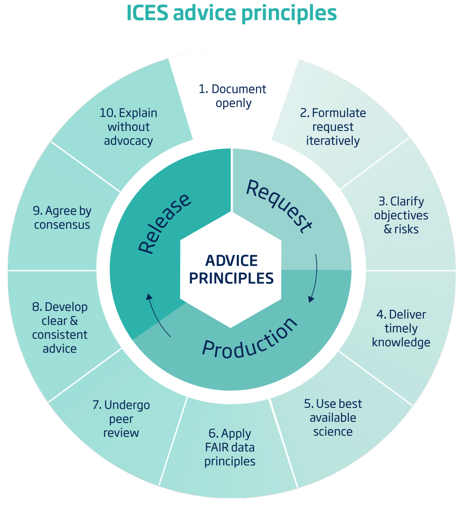
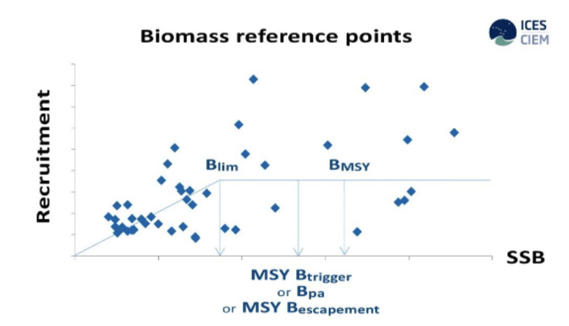
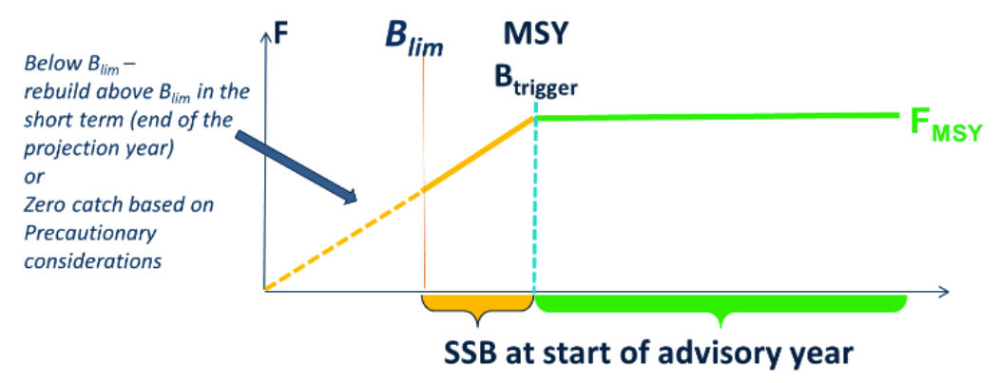
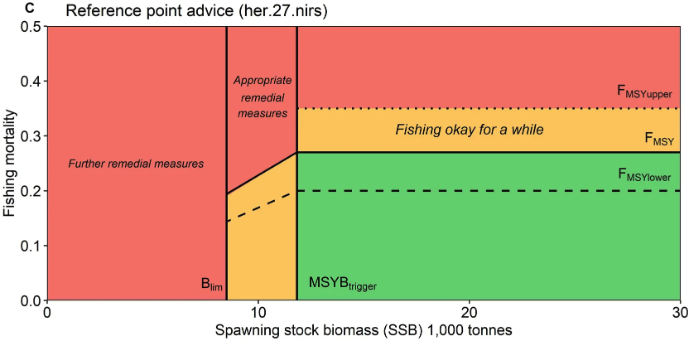
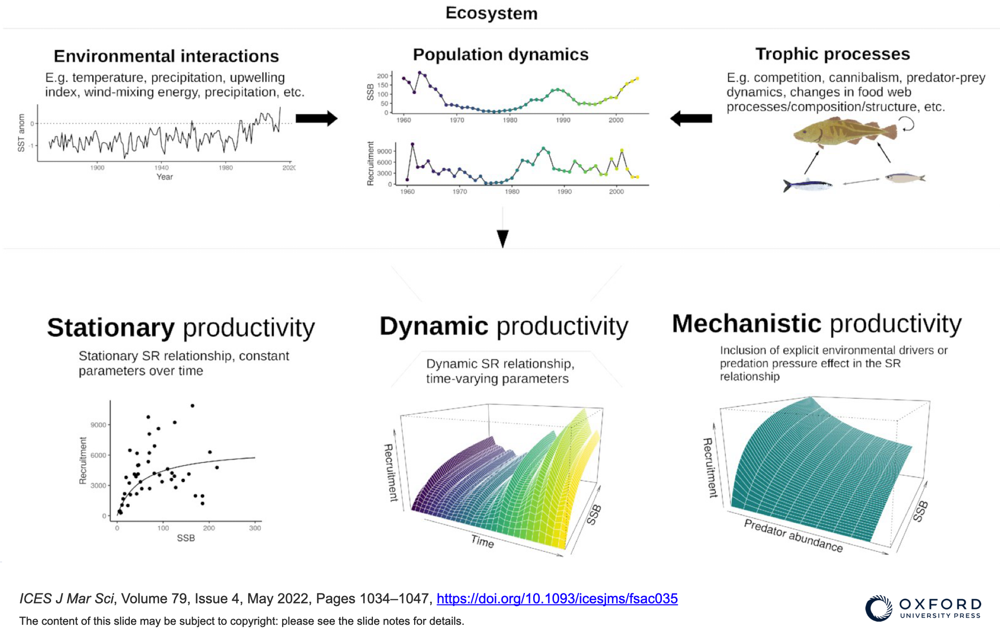
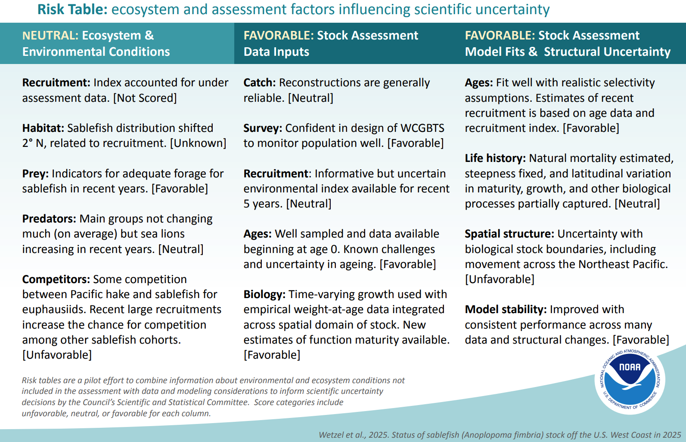

class: top, left

```{r setup, include=FALSE}

options(htmltools.dir.version = FALSE)
knitr::opts_chunk$set(echo = F,
                      fig.retina = 3,
                      warning = F,
                      message = F)
#Plotting and data libraries
library(tidyverse)
library(tidyr)
library(ggrepel)
library(here)

```

```{r, load_refs, include=FALSE, cache=FALSE}
library(RefManageR)
BibOptions(check.entries = FALSE,
           bib.style = "authoryear",
           cite.style = "authoryear",
           longnamesfirst = FALSE,
           max.names = 1,
           style = "markdown")
myBib <- ReadBib("./DeepUncertaintyMSE.bib", check = FALSE)

#,
#           hyperlink = FALSE,
#           dashed = FALSE

```

.pull-left-40[
## Overview of lecture

Briefly review US and northern Europe
*  Who manages fisheries?
*  Who provides scientific advice?

What is the International Council for the Exploration of the Seas ([ICES](https://www.ices.dk/Pages/default.aspx))?

What is the ICES advice framework?

How is ICES management advice evolving?


]

--


.pull-right-60[
## Regional Fisheries Management Organizations (RFMOs)

Tuna and highly migratory focus: 
*  International Commission for the Conservation of Atlantic Tunas ([ICCAT](https://www.iccat.int/en/)) 
*  Inter-American Tropical Tuna Commission ([IATTC](https://www.iattc.org/)) 
*  Western and Central Pacific Fisheries Commission ([WCPFC](https://www.wcpfc.int/))

Salmon focus:
*  North Atlantic Salmon Conservation Organization ([NASCO](https://nasco.int/))
*  North Pacific Anadromous Fish Commission ([NPAFC](https://www.npafc.org/))

Regional ecosystem focus:
*  Northwest Atlantic Fisheries Organization ([NAFO](https://www.nafo.int/About-us))
*  Commission for the Conservation of Antarctic Marine Living Resources ([CCAMLR](https://www.ccamlr.org/))

And many others that I won't be talking about

.footnote[
Sources: (left) [ICES ASC 2026 Bas Kohler Cartoons](https://www.ices.dk/events/Documents/ICES%20ASC%202026-BasKohler%20cartoons.pdf).  (right) [NOAA](https://www.fisheries.noaa.gov/international-affairs/international-and-regional-fisheries-management-organizations) and [US Dept of State Archive](https://2021-2025.state.gov/key-topics-office-of-marine-conservation/international-fisheries-management/)

]
]

---
## Fishery management in the US: participatory regional process

Eight regional Fishery Management Councils establish plans for sustainable management of stocks within their jurisdictions. All are governed by the same law, but tailor management to their regional stakeholder needs.  
.center[

]

More information: http://www.fisherycouncils.org/  
https://www.fisheries.noaa.gov/topic/laws-policies#magnuson-stevens-act

---
## Main concepts  `r Citep(myBib, "dicosimo_use_2010", "methot_implementing_2014")`
.pull-left-40[
MSY: *the largest long-term average catch or yield that can be taken from a stock or stock complex**  

Overfishing 
- *too much fishing mortality*
- $F > F_{MSY}$

Overfished 
- *too little biomass*
- $B < \frac12 B_{MSY}$

Rebuilding
- *grow overfished stock back*
- $B = B_{MSY}$


]
.pull-right-60[
```{r stock-status, warning=F, fig.width=8, fig.asp=0.7}
#fig.cap = paste0("Mid-Atlantic Fishery Management Council stock status"),
a <- ecodata::plot_stock_status(report = "MidAtlantic")

a$p + ggplot2::coord_cartesian(xlim=c(0,2), ylim=c(0,2)) +
  ggplot2::theme(text = ggplot2::element_text(size = 20)) +
  ggplot2::ggtitle("") +
  ggplot2::theme(legend.position = "none") #+
#  ggplot2::annotation_custom(gridExtra::tableGrob(a$unknown,
#                             theme = gridExtra::ttheme_default(base_size = 10), 
#                             rows=NULL), 
#                             xmin=0.8, xmax=1.8, ymin=1.5, ymax=2)
```
.center[Mid-Atlantic Fishery Management Council stock status]
]

<p style="color:#FF8C00;">*<i>under prevailing ecological, environmental conditions and fishery technological characteristics (e.g., gear selectivity), and the distribution of catch among fleets.</i></p>


---
background-image: url("https://github.com/sgaichas/presentations/raw/main/docs/EDAB_images/OFLABCACLetc.png")
background-position: left

## Getting to the quota
.right[
SSC = Scientific and  
Statistical Committee

MFMT = Maximum Fishing  
Mortality Threshold,  
typically $F_{MSY}$


**Councils have different methods**

**But all use F buffers**
]

---
## "In both constant F and ramped F control rules, precautionary buffers are used to reduce the OFL to the ABC to protect against scientific uncertainty." `r Citep(myBib, "free_harvest_2023")` Fig. 2

.center[

]

---
## Where does the science come from?

.pull-left[
Mainly NOAA/NMFS Science Centers in the US


.footnote[
More info: https://www.fisheries.noaa.gov/contact-directory/science-centers
]
]

--


.pull-right[
Mainly ICES in Northern Europe, via national labs


.footnote[
Source: https://www.ices.dk/about-ICES/who-we-are/Pages/Who-we-are.aspx
]
]


---
## What is the International Council for the Exploration of the Seas (ICES)?

.pull-left-30[ 
ICES is an intergovernmental organization with 19 Member Countries: 
.table[ 
*  Belgium
*  Canada
*  Denmark
*  Estonia
*  Finland
*  France
*  Germany
*  Iceland
*  Ireland
*  Latvia
*  Lithuania
*  The Netherlands
*  Norway
*  Poland
*  Portugal
*  Spain
*  Sweden
*  United Kingdom
*  United States of America
]
]

.pull-right-70[

]


---
## Fishery management in Europe: multiple jurisdictions and legal frameworks

.pull-left-70[
Ecoregions

]

--

.pull-right-30[
European Union (yellow) 

ICES Member States (orange)

]


---
ICES provides scientific advice on fishing opportunities on over 260 stocks to various relevant management authorities in the Northeast Atlantic, including areas beyond national jurisdiction. 

The advice gives scientifically based catch limits in line with regional policies to apply a precautionary approach and maximize sustainable yields. 

.pull-left[
## European Common Fisheries Policy (CFP)

## NEAFC

## NASCO

]

.pull-right[
## UK

## Norway

## Iceland

]

---
background-image: url(https://github.com/sgaichas/HSpresentations/raw/main/docs/images/Advisory_framework_text.jpg)
background-size: 700px
background-position: bottom 130px left 30px

## ICES Advice Process: Framework and Principles

.pull-left-60[

.footnote[
Sources: https://www.ices.dk/about-ICES/how-we-work/Pages/Advisory_process.aspx   
ICES (2025). Advisory Plan. ICES Convention, policies, and strategy. Report. https://doi.org/10.17895/ices.pub.28238150.v1  
ICES (2025). Guidelines for ICES advisory process. Version 1. ICES Guidelines and Policies - Advice Technical Guidelines. 29 pp. https://doi.org/10.17895/ices.pub.30885011 
]
]

--

.pull-right-40[

]


---
background-image: url(https://github.com/sgaichas/HSpresentations/raw/main/docs/images/ICESadviceproduction.png), url(https://github.com/sgaichas/HSpresentations/raw/main/docs/images/ICESadviceproducts.png)
background-size: 600px, 550px
background-position: bottom 80px left 20px, bottom 70px right 20px

## ICES Advice: Production and Products

.footnote[
Source: ICES (2025). Advisory Plan. ICES Convention, policies, and strategy. Report. https://doi.org/10.17895/ices.pub.28238150.v1
]

---
background-image: url(https://github.com/sgaichas/HSpresentations/raw/main/docs/images/ICES_assessment_adviceloop.png)
background-size: 900px
background-position: bottom 30px right

## ICES Assessments and Fishing Opportunity Advice

.pull-left-30[
Full ICES network produces: 

Expert Group: WG 
*  Basis for advice (1-4)
*  First draft 

ADG 
*  Review advice (5)
*  Finalize draft 

ACOM 
*  Final review 
*  Final approval 

Secretariat manages
*  Support process
*  Publish advice

.footnote[
Source: https://doi.org/10.17895/ices.pub.24866088
]
]

.pull-right-70[

]

---
## ICES Assessment Data Categories

.table[

>Category 1 – Stocks with quantitative assessments; includes stocks with full analytical assessments and forecasts that are either age-/length-structured or based on production models.

>Category 2 – Stocks with analytical assessments and forecasts that are only treated qualitatively as well as stocks with surplus production models, e.g. SPiCT, JABBA, without an MSE; includes stocks with quantitative assessments and forecasts which, for a variety of reasons, are considered indicative of trends in fishing mortality, recruitment, and biomass.

>Category 3 – Stocks for which survey-based assessments or exploratory assessments indicate trends; includes stocks forwhich survey, trends-based assessment, or other indices and life history information are available that provide reliable indications of trends in stock metrics such as total mortality, recruitment, and biomass.

>Category 4 – Nephrops stocks where information on possible abundance can be inferred and stocks for which a reliable time-series of catch can be used to approximate MSY. This is where there are reasonable scientific grounds to use life-history and density information from functional units to provide advice.

>Category 5 – Stocks for which either only data on landings or a short time-series of catch are available.

>Category 6 – Stocks for which there are negligible landings and stocks caught in minor amounts as bycatch; includes stocks where landings are negligible in comparison to discards as well as stocks that are primarily caught as bycatch species in other targeted fisheries.

]

.footnote[
Source: ICES (2025) Advice on fishing opportunities. In Report of the ICES Advisory Committee, 2025. ICES Advice 2025, section 1.1.1. https://doi.org/10.17895/ices.pub.30712466
]

---
## ICES Reference Points and Advice Rule (Category 1-2)

.pull-left[


Below $B_{lim}$ recruitment is impaired

$MSY B_{trigger}$ is fifth percentile of $B_{MSY}$) when fished at $F_{MSY}$  

$B_{pa}$ is 95th percentile of the distribution of the estimated SSB if the true SSB equals $B_{lim}$

.footnote[
[ICES fisheries management reference points for category 1 and 2 stocks](https://doi.org/10.17895/ices.advice.7891)   
[ICES Advice on Fishing Opportunities 2025](https://doi.org/10.17895/ices.pub.30712466)
]
]

.pull-right[


Combines MSY and precautionary approach (PA)

$F_{MSY}$ is the target

Ranges of $F_{MSY lower}$ and $F_{MSY upper}$ <= 5% reduction in long-term yield, compared
with the MSY obtained by fishing at $F_{MSY}$ in the long term. 

$F_{MSY upper}$ is capped for <= 5% chance $B$ < $B_{lim}$ 

$F_{pa}$ is $F$ that results in no more than 5% probability of bringing the spawning stock to below $B_{lim}$ in the long term


]

???
ICES (2021). ICES fisheries management reference points for category 1 and 2 stocks. Technical Guidelines. In Report of the ICES Advisory Committee, 2021. ICES Advice 2021, Section 16.4.3.1. https://doi.org/10.17895/ices.advice.7891

ICES (2025). ICES Guidelines - Advice rules for stocks in category 2 and 3. Version 3. ICES Guidelines and Policies - Advice Technical Guidelines. 31 pp. https://doi.org/10.17895/ices.pub.28506179

---
## Key differences from US system

.pull-left[

$F_{MSY}$ is the target

$F$ > $F_{MSY}$ permitted under some circumstances

No $B_{MSY}$ target is defined

No mandated rebuilding time to $B_{MSY}$

US does not define stock specific $B_{lim}$

Assessment uncertainty is in $B_{pa}$ reference point

Zero catch advice required under some circumstances:  
*  Stock below $B_{lim}$ and 
*  Retrospective pattern outside bounds or short term forecast highly sensitive or 
*  No $F$ gets SSB > $B_{lim}$ with 50% probability at the end of the projection year

]

.pull-right[



## Early 2027

Two workshops to evolve the advice rule:

WKFOREPROJ forecasts and projections
Guidelines for conditioning simulation models for F, multiannual advice, rebuilding strategies

WKREFRAME update recommendations on $F$, $MSY B_{trigger}$, $B_{lim}$, and roadmap for ecosystem considerations

]

.footnote[
Source: [Bentley et al. 2021 ICES JMS](https://www.frontiersin.org/journals/marine-science/articles/10.3389/fmars.2021.602072/full)
]

---
## Advice Structure

.pull-left[
*  ICES advice on fishing opportunities ("Headline") 
*  ICES non-fisheries conservation considerations   
*  Stock development over time  
*  (Conservation status)   
*  Catch scenarios 
*  Basis of the advice 
*  Quality of the assessment 
*  Issues relevant for the advice 
*  Reference points 
*  Basis of the assessment  
*  History of the advice, catch, and management (tables) 
*  History of the catches (tables) 
*  Summary of the assessment (tables) 
*  Sources and references 
]

.pull-right[]

---
## Example Advice: Elasmobranchs

```{r, include=FALSE}

all_results <- readRDS("~/Documents/Work/Presentations/HSpresentations/Projects/ICES_ACOM/NWWAC/advicedat/2026_elasmos.rds")

stocks <- unique(all_results$stock_code)

```

Celtic Seas Region advice released in autumn 2026

```{r}
all_results |> dplyr::select(title, stock_code) |>
  dplyr::arrange(factor(stock_code, levels = c("rjc.27.6",
                                               "rjc.27.7afg",
                                               "rje.27.7fg",
                                               "rjm.27.67bj",
                                               "rjm.27.7ae-h",
                                               "rjn.27.678abd",
                                               "rju.27.7de",
                                               "por.27.nea", 
                                               "dgs.27.nea"))) |>
  flextable::flextable() |>
  flextable::autofit() |>
  flextable::set_header_labels(title = "Stock name", stock_code = "Stock code")

```

Examples of Category 3, 2, 5, and 1 assessments illustrating the breadth of methods and advice

---
```{r, results='asis'}

# following the example here https://github.com/orgs/quarto-dev/discussions/2403

st <- all_results |> dplyr::filter(stock_code == stocks[3]) #"rjc.27.6"
st_scen <- st |> dplyr::select(stock_code, catch_scenarios)  |> tidyr::unnest(catch_scenarios)
#

src <- knitr::knit_expand(text = c(
    "background-image: url(\"https://github.com/sgaichas/HSpresentations/raw/main/{{ st$figure_png }}\")",
    "background-size: 900px",
    "background-position: bottom 30px left -20px",
    "## {{ st$title }}",
    "",
    "Advice for `r unlist({{ st$catch_advice }})[[1]]` and `r unlist({{ st$catch_advice }})[[2]]` `r unlist({{ st$catch_advice }})[[6]]` <= `r unlist({{ st$catch_advice }})[[4]]` t",
    ".pull-left-70[",
    "",
    "",
    ".footnote[ {{ st$advice_url }}]",
    "]",
    "",
    ".pull-right-30[",
    "{{ st$fishing_pressure }}",
    "",
    "{{ st$stock_size }}",
    "",
    "{{ st$advice_change_note }}",
    "",
    "]",
    "---",
    "## {{ st$title }}",
    "",
    ".pull-left-30[",
    "Total landings ({{ st$catch_year }}):  {{ st$landings_t }} t, {{ st$catch_dist_note }}",
    "",
    ".footnote[ {{ st$advice_url }}]",
    "]",
    ".pull-right-70[",
    "```{r}",
    "#| echo: false",
    "st_scen |>",
    "dplyr::select(!c(1:3)) |>",
    "flextable::flextable() |>",
    "flextable::padding(padding.top = 3, part = \"all\") |>",
    "flextable::padding(padding.bottom = 3, part = \"all\") |>",
    "flextable::autofit()",
    "```",
    "",
    "]",
    "---"))
res <- knitr::knit_child(text = src, quiet = TRUE)
cat(res, sep = '\n')
```

```{r, results='asis'}

st <- all_results |> dplyr::filter(stock_code == stocks[9]) #"rju.27.7de"
st_scen <- st |> dplyr::select(stock_code, catch_scenarios)  |> tidyr::unnest(catch_scenarios)
#

src <- knitr::knit_expand(text = c(
    "background-image: url(\"https://github.com/sgaichas/HSpresentations/raw/main/{{ st$figure_png }}\")",
    "background-size: 900px",
    "background-position: bottom 30px left -20px",
    "## {{ st$title }}",
    "",
    "Advice for `r unlist({{ st$catch_advice }})[[1]]` `r unlist({{ st$catch_advice }})[[9]]` <= `r unlist({{ st$catch_advice }})[[5]]` t and ",
    "`r unlist({{ st$catch_advice }})[[2]]` `r unlist({{ st$catch_advice }})[[10]]` <= `r unlist({{ st$catch_advice }})[[6]]` t",
    ".pull-left-70[",
    "",
    "",
    ".footnote[ {{ st$advice_url }}]",
    "]",
    "",
    ".pull-right-30[",
    "{{ st$fishing_pressure }}",
    "",
    "{{ st$stock_size }}",
    "",
    "{{ st$advice_change_note }}",
    "",
    "]",
    "---",
    "## {{ st$title }}",
    "",
    "Total catch ({{ st$catch_year }}):  {{ st$total_catch_t }} t, Discard (all live + dead) rate: `r round({{ st$discard_rate }}*100)`%; Dead discard (>=50 cm) rate: `r round((546/3785)*100)`%; {{ st$forecast_values[[1]]$variable[1] }}: {{ st$forecast_values[[1]]$value[1] }};  {{ st$forecast_values[[1]]$variable[2] }}: {{ st$forecast_values[[1]]$value[2] }}",
    "",
    "```{r}",
    "#| echo: false",
    "st_scen |>",
    "dplyr::select(!c(1:3)) |>",
    "dplyr::rename_all(function(x) gsub(\"_\", \" \", x)) |>",
    "dplyr::mutate(year = as.character(year)) |>",
    "flextable::flextable() |>",
    "flextable::padding(padding.top = 2, part = \"all\") |>",
    "flextable::padding(padding.bottom = 2, part = \"all\") |>",
    "flextable::autofit()",
    "```",
    "",
    ".footnote[ {{ st$advice_url }}]",
    "---"))
res <- knitr::knit_child(text = src, quiet = TRUE)
cat(res, sep = '\n')
```
```{r, results='asis'}

st <- all_results |> dplyr::filter(stock_code == stocks[2]) #"por.27.nea"
st_scen <- st |> dplyr::select(stock_code, catch_scenarios)  |> tidyr::unnest(catch_scenarios)
#

src <- knitr::knit_expand(text = c(
    "background-image: url(\"https://github.com/sgaichas/HSpresentations/raw/main/{{ st$figure_png }}\")",
    "background-size: 900px",
    "background-position: bottom 30px left -20px",
    "## {{ st$title }}",
    "",
    ".pull-left-70[",
    "Advice for `r unlist({{ st$catch_advice }})[[1]]` to `r unlist({{ st$catch_advice }})[[2]]` `r unlist({{ st$catch_advice }})[[6]]` <= `r unlist({{ st$catch_advice }})[[4]]` t",
    "",
    "Total landings (2025):  10 t, discards Unquantified",
     "```{r}",
    "#| echo: false",
    "st_scen |>",
    "dplyr::select(!c(1:3)) |>",
    "flextable::flextable() |>",
    "flextable::autofit()",
    "```",
    "",
    ".footnote[ {{ st$advice_url }}]",
    "]",
    "",
    ".pull-right-30[",
    "ICES cannot assess the stock and exploitation status relative to maximum sustainable yield (MSY) reference points because these values were not updated in 2026 and information to define precautionary (PA) reference points is not available.",
    "",
    "No new biomass index values were available since 2019.",
    "The advised catch for 2027–2030 has decreased from the previous advice because of the change in the ICES stock data category and application of the precautionary buffer.",
    "",
    "]",
    "",
    "---"))
res <- knitr::knit_child(text = src, quiet = TRUE)
cat(res, sep = '\n')
```


```{r, results='asis'}

st <- all_results |> dplyr::filter(stock_code == stocks[1]) #"dgs.27.nea"
st_scen <- st |> dplyr::select(stock_code, catch_scenarios)  |> tidyr::unnest(catch_scenarios)
#

src <- knitr::knit_expand(text = c(
    "background-image: url(\"https://github.com/sgaichas/HSpresentations/raw/main/{{ st$figure_png }}\")",
    "background-size: 900px",
    "background-position: bottom 30px left -20px",
    "## {{ st$title }}",
    "",
    "Advice for `r unlist({{ st$catch_advice }})[[1]]` `r unlist({{ st$catch_advice }})[[5]]` <= `r unlist({{ st$catch_advice }})[[3]]` t and ",
    "`r unlist({{ st$catch_advice }})[[2]]` `r unlist({{ st$catch_advice }})[[6]]` <= `r unlist({{ st$catch_advice }})[[4]]` t",
    ".pull-left-70[",
    "",
    "",
    ".footnote[ {{ st$advice_url }}]",
    "]",
    "",
    ".pull-right-30[",
    "{{ st$fishing_pressure }}",
    "",
    "{{ st$stock_size }}",
    "",
    "{{ st$advice_change_note }}",
    "",
    "]",
    "---",
    "## {{ st$title }}",
    "",
    "Total catch ({{ st$catch_year }}):  {{ st$total_catch_t }} t, Discard rate: `r round({{ st$discard_rate }}*100)`%",
    "",
    "{{ st$forecast_values[[1]]$variable[1] }}: {{ st$forecast_values[[1]]$value[1] }}; {{ st$reference_points[[1]]$reference_point[1] }}: 0.042",
    "",
    "Btot (2026): 679893 t; {{ st$forecast_values[[1]]$variable[2] }}: {{ st$forecast_values[[1]]$value[2] }} t ; {{ st$reference_points[[1]]$reference_point[2] }}: {{ st$reference_points[[1]]$value_num[2] }} t and {{ st$reference_points[[1]]$reference_point[3] }}: {{ st$reference_points[[1]]$value_num[3] }} t",
    "",
    "```{r}",
    "#| echo: false",
    "st_scen |>",
    "dplyr::select(!c(1:4)) |>",
    "dplyr::rename_all(function(x) gsub(\"_\", \" \", x)) |>",
    "flextable::flextable() |>",
    "flextable::autofit()",
    "```",
    "",
    ".footnote[ {{ st$advice_url }}]",
    "---"))
res <- knitr::knit_child(text = src, quiet = TRUE)
cat(res, sep = '\n')
```


background-image: url(https://github.com/sgaichas/HSpresentations/raw/main/docs/images/ICESadvisoryplan2025.png)
background-size: 350px
background-position: bottom 70px right 30px

## How is ICES Advice Evolving?

.pull-left-70[
Ecosystem and climate informed advice priorities:

*  Further evolve our advice framework for fisheries to take account of ecosystem and climate change impacts

*  Develop cumulative impact assessment methods and advice framework

*  Develop trade-off analysis methods for ecosystem-informed advice

*  Develop climate-informed advice products 

*  Continue to provide and develop spatially explicit advice to inform species management, habitat conservation, and restoration plans.

*  Draft and publish further ICES Viewpoints to address new advisory priorities

*  Implement the Framework for Ecosystem Informed Science and Advice (FEISA) in targeted advice products

.footnote[
Source: ICES (2025). Advisory Plan. ICES Convention, policies, and strategy. Report. https://doi.org/10.17895/ices.pub.28238150.v1
]
]

.pull-right-30[]

---
## Progress

In early 2026, Advice Requesters, Stakeholders, and ACOM reviewed options for evolving our advice framework for fisheries to take account of ecosystem and climate change impacts. Reviewed options included:

.icesgreenbox[
Option 1: Implementation of ecosystem-informed **single-stock reference points**. 

Option 2: Inclusion of **qualitative, risk- and objectives-based statements** in advice. 

Option 3: Provision of **single, multispecies or mixed fisheries catch scenarios conditioned for** observed, anticipated, or projected **climate change or ecosystem effects**. 

Option 4: Forecast of **long-term impacts of climate change** in [fisheriesXplorer](https://ices-taf.shinyapps.io/fisheriesXplorer/). 
]

For each option, both current operational approaches and potential approaches based on scientific literature were identified.

Discussions centered on classifying each option according to utility for short term and long term management needs and alignment with current management and legal frameworks.  

???

---
## Option 1 Example: Dynamic Reference Points

.center[

]

.footnote[Source: Silvar-Viladomiu et al., 2022. https://academic.oup.com/icesjms/article/79/4/1034/6549169]


---
## Option 2 Example: Stock Level Risk Statements

```{r}

Tab4 <- readr::read_csv("https://github.com/sgaichas/HSpresentations/raw/main/Conferences/BevanUW_2026-02-19/data/WestCoastRiskFramework.csv")

flextable::flextable(Tab4)|>
  flextable::set_caption("Pacific Pilot Risk Levels and Indicator Criteria.") |>
  flextable::width(width = c(4,4,4,4)) |>
  flextable::bg(i = c(1:3), bg=c("#00FF0050", "white", "#FF000050"))
```

Potential Action:  
Favorable Conditions &rarr; <span style="background-color:#00FF0050;">Decrease Risk Buffer (Higher Catch Recommendation)</span>  
Neutral Conditions &rarr; Keep Standard Risk Buffer (Standard Catch Recommendation)  
Unfavorable Conditions &rarr; <span style="background-color:#FF000050;">Increase Risk Buffer (Lower Catch Recommendation)</span>

.footnote[
Source: [CCIEA Risk Table Report](https://www.pcouncil.org/documents/2024/08/h-1-a-cciea-team-report-1-cciea-risk-table-report-on-fep-initiative-4.pdf/)
]

---
## Option 2 Example: Stock Level Risk Statements

.center[

]

.footnote[
Source: [2025 US Pacific Stock Assessment Summaries](https://www.pcouncil.org/documents/g-3-situation-summary-adopt-stock-assessments/g-3-a-supplemental-nwfsc-swfsc-report-1-2025-west-coast-groundfish-stock-assessment-at-a-glance/)
]

---
background-image: url(https://github.com/sgaichas/HSpresentations/raw/main/docs/images/Feco_Bentley.png)
background-size: 1000px
background-position: bottom 50px center

## Option 3 Example: Conditioned Catch Advice

## $F_{ECO}$

*  Stock assessment gives range of ICES Fs
*  Indicators linked to stock dynamics tested and selected
*  Current indicator status compared with previous years
*  Indicator status gives $F_{ECO}$ reference point within ICES F ranges

.footnote[Source: Bentley et al. 2021 https://www.frontiersin.org/journals/marine-science/articles/10.3389/fmars.2021.602072/full]

---
background-image: url(https://github.com/sgaichas/HSpresentations/raw/main/docs/images/codclimateprojection.png), url(https://github.com/sgaichas/HSpresentations/raw/main/docs/images/hakehabitatsuitabilityproj.png), url(https://github.com/sgaichas/HSpresentations/raw/main/docs/images/hakehabitatsuitabilityvars.png)
background-size: 600px, 370px, 150px
background-position: bottom 20px left 20px, bottom 20px right 170px, bottom 100px right 20px

## Option 4 Example: Long-term Climate Impacts

.pull-left[
Stock abundance and catch forecast  under climate change: NS Cod
]

.pull-right[
Spatial suitability model under climate change: Northern Hake
]

.footnote[
Source: https://ices-taf.shinyapps.io/SEAwiseToolbox/
]
---
## Reflections by Requesters, Stakeholders, and ACOM

Agreed that quantitative changes to headline advice (Options 1 and 3) are more effective than qualitative risk statements alone. 

Qualitative advice (Option 2) could be a useful initial step if it can lead to quantitative advice (Option 3). 

Some supported the inclusion of qualitative information for context, while others were concerned about confusion based on qualitative information alone. 

Option 4 was seen as suitable for a longer term planning horizon, if long term projection uncertainty is expressed appropriately. 

--

Technical and capacity challenges were noted with implementing any option across many or all stocks. 

Robustness of the science, accuracy of the advice, and a collaborative approach, including stakeholder engagement, were emphasized as important to success. 

ACOM:  a conceptual modeling approach could provide a basis for developing and communicating important climate and ecosystem influences on a stock, as well as for prioritizing quantitative indicator development.  

ACOM: Option 1 could include adding climate and ecosystem drivers in short term projections. Single stock reference points are updated regularly, and have been adjusted based on clear changes in stock productivity. 

---
## Moving Forward

*A structured approach combining existing ICES resources as a prototype process for evolving advice*

<span style="color: blue;">A Baltic example</span>

Structure work to enhance coordination and collaborations across expert groups and projects to fulfill existing ToRs and research needs, making the best use of existing resources while evolving the advice framework. Outcomes would include both prototype climate/ecosystem informed advice for a particular stock, and prototype processes for developing this advice that could be transferred to other stocks and regions.

Collaborators including Advice requestors, stakeholders, and experts from <span style="color: blue;">ICES WGBFAS, WGIAB, WGECOBAL, WGBIFS, WGSAM</span>, and other groups as needed would first agree on the priority stock(s) and provide a rationale for stock selection. 

.pull-left[
Steps:

1. Conceptual model of stock life history
2. Standard list of ecosystem factors to evaluate
3. Structured conversation between assessors, ecosystem scientists, and stakeholders
4. Indicator development
5. Integration in advice framework

]

.pull-right[
Collaboration potential with current resources:

*  <span style="color: blue;">WGBFAS</span> has identified stock research needs
*  <span style="color: blue;">WGIAB</span> ToR for assessment indicators
*  <span style="color: blue;">WGECOBA</span>L ToR for environmentally informed reference points
*  <span style="color: blue;">WGSAM</span> identified need for broader mortality sources
]

---
## Last week's WKFISHECO &rarr; a systematic approach for ICES?

.pull-left[
<span style="color: blue;">Stock specific ecosystem indicators</span> can be derived from literature review combined with indicator testing using an [Ecosystem Socioeconomic Profile](https://www.tandfonline.com/doi/full/10.1080/08920753.2023.2291858),   


or using a <span style="color: blue;">**structured conversation among experts**</span> as piloted in the Pacific 

.footnote[
Image courtesy [NEFSC](https://repository.library.noaa.gov/view/noaa/66453)
]
]

.pull-right[
Modify [Pacific ecosystem factors](https://www.pcouncil.org/documents/2024/08/h-1-a-cciea-team-report-1-cciea-risk-table-report-on-fep-initiative-4.pdf/) for ICES regions:

*  <span style="color: blue;">Food webs</span> (e.g., predator abundance or productivity, competitor abundance or productivity, spatial overlap with predators/competitors, prey abundance) 
*  <span style="color: blue;">Habitat availability</span> (e.g., do current or near-term predictions of ocean temperatures and oxygen match known optimal ranges for [priority species] life history stages, closed area regulations) 
*  <span style="color: blue;">Changes in ecosystem productivity</span> (e.g., upwelling indices, chlorophyll a, abundance of low trophic level organisms)  
*  <span style="color: blue;">Physiological indices</span> (e.g., growth, condition, pathogens/parasites, stomach weight/fullness) 
*  <span style="color: blue;">Reproductive indices</span> (e.g., maturity, fecundity, spawn timing and duration)  

]

---
## Planning for facilitated scoping meeting early in a benchmark. Modify [Pacific structured conversation](https://www.pcouncil.org/documents/review-material-cciea-team-report-on-fep-initiative-4/) for ICES?

.pull-left[
 <span style="color: blue;">Stock assessors</span>, we ask that you think about how you would characterize uncertainty in your assessment. 

* Based on your work on the assessment, what do you think are the greatest sources of uncertainty in the most recent assessment? Are any of these sources of uncertainty outside the norm you typically expect for this assessment?

* In the assessment, how were the fits to the data overall? Were there any patterns in residuals or other indicators of especially poor fits or concerning diagnostics? 

* Are there any ecosystem processes that are currently included in the stock assessment model for [species]? 
]


.pull-right[
 <span style="color: blue;">Ecosystem scientists</span>, we ask that you think about these concepts and processes in advance of our meeting and review any relevant literature you know of about how they may be influenced by ocean and ecosystem conditions.

* What are the important oceanographic or ecological drivers in this ecosystem for [species]? 

<span style="color: blue;">For all</span>: Are there any ecosystem processes that are not included in the assessment model but that you think could have a potential link to [species] recruitment, growth, fecundity, mortality, habitat availability, or distribution?

Are there any ecosystem processes that we didn’t already cover in this conversation that could have a potential link to [species] recruitment, growth, fecundity, or migration?
]

---
## Questions and Discussion?

## References

.table[
```{r refs, echo=FALSE, results="asis"}
PrintBibliography(myBib)
```
]

---
background-image: url(https://github.com/sgaichas/HSpresentations/raw/main/docs/images/ICESthankyougreen.png)
background-size: cover
background-position: center

class: middle

Slides available at https://sgaichas.github.io/HSpresentations/  
Contact: <sgaichas@hydrascientificllc.com> and <sarah.gaichas@ices.dk>


