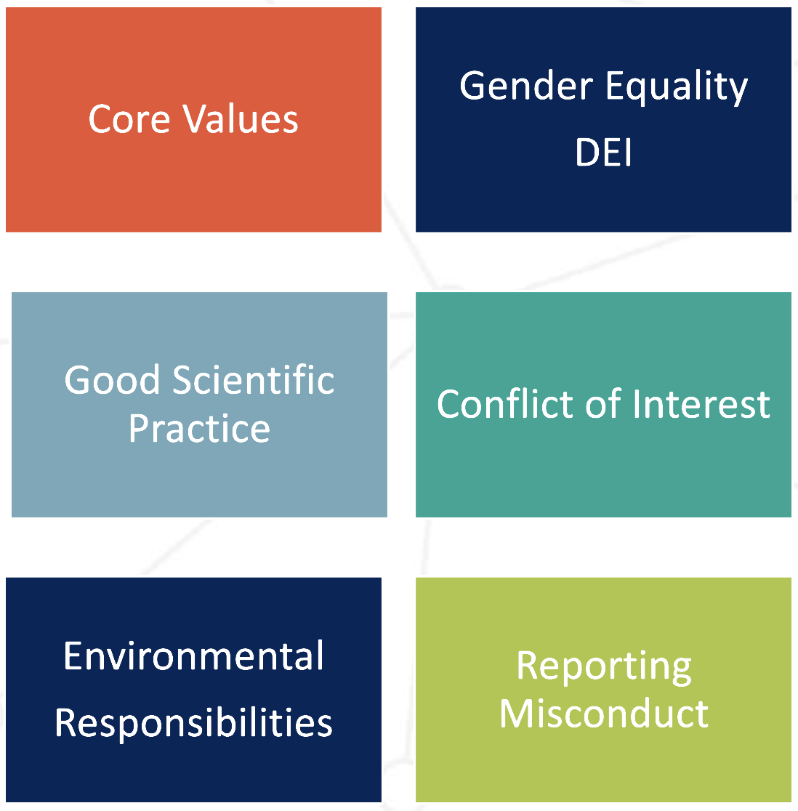
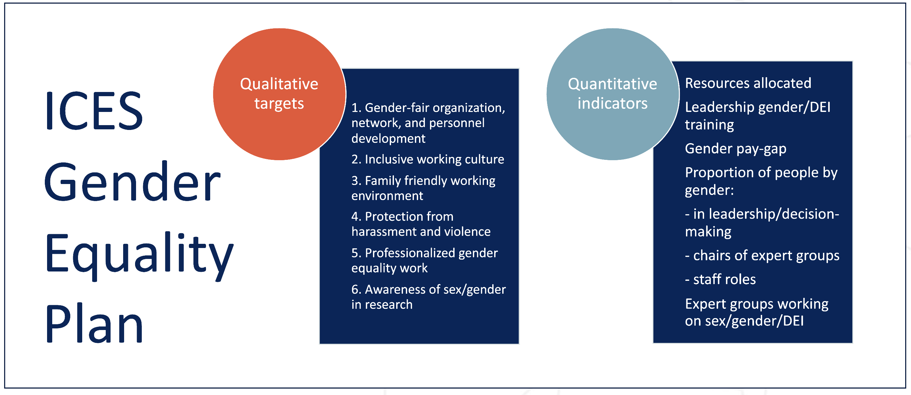

class: top, left

```{r setup, include=FALSE}

options(htmltools.dir.version = FALSE)
knitr::opts_chunk$set(echo = F,
                      fig.retina = 3,
                      warning = F,
                      message = F)
#Plotting and data libraries
library(tidyverse)
library(tidyr)
library(ggrepel)
library(here)

```

# Agenda 

1.  Welcome, Introductions, and ICES Code of Ethics, Conduct, etc. (Sarah G, ~5 minutes) 

1.  Purpose and scope of the ACOM–WGBAST subgroup (Sarah G, ~10 minutes) 
       + ACOM’s mandate for the subgroup 
       + relationship to, and boundaries with, the benchmark process 
       + key advice-framework questions that the subgroup should address 
       + expected outputs and how these feed back to ACOM 
       
1.  Overview of proposed benchmark methods and reference points (benchmark team, ~30 minutes) 

1.  Begin discussion relating proposed methods and reference points to standard ICES advice framework (all, ~30 min) 

1.  Priorities and working arrangements for the ACOM–WGBAST subgroup (all, ~10 min) 

1.  Plan further meetings as needed (Sarah G and all, ~5 min) 

1.  Adjourn 


---
# Introduction

*We would like to foster equitable and thoughtful communication and discussion*

*Be mindful that English is not primary language of majority of participants* 

For online (all!) participants: 

*  Please mute your microphone when not speaking

*  Camera on when speaking when you feel comfortable

*  Recommend using headset

*  Please raise your hand on Webex if you want to speak

https://doi.org/10.17895/ices.pub.21647825

---
# CODE OF ETHICS AND PROFESSIONAL CONDUCT

.pull-left-60[
The  Code  of  Ethics  and  Professional  Conduct  outlines ICES principles, guidelines, and practices for key areas of organizational activity.

The Code of Ethics and Professional Conduct applies to anyone partaking in any ICES activity—including staff, officials, members, participants, speakers, volunteers, and exhibitors. Meeting chairs and event organizers are expected to set the tone for inclusive collaboration. The chair/organizer should be especially alert to any bias or discrimination exhibited against others and act to prevent it. 

The  Code  of  Ethics  and  Professional Conduct  does  not  affect  the  application  of  other  relevant  policies, regulations, rules, or laws regulating the premises where the ICES activity takes place. 
]

.pull-right-40[



]

---
background-image: url(https://github.com/sgaichas/HSpresentations/raw/main/docs/images/ICEScorevalue.png)
background-size: 950px
background-position: bottom 15px center

# CORE VALUES


---
# Gender Equality, Diversity, Equity, and Inclusion



---
background-image: url(https://github.com/sgaichas/HSpresentations/raw/main/docs/images/ICESgoodscipractice.png)
background-size: 500px
background-position: left 50px bottom 30px

# GOOD SCIENTIFIC PRACTICE

.pull-left[

]

.pull-right[

*  Authorship 

*  Intellectual property & data 

*  Misconduct 

*  List of international document 
]


---
background-image: url(https://github.com/sgaichas/HSpresentations/raw/main/docs/images/ICESconflictinterest.png)
background-size: 150px
background-position: left 50px bottom 50px

# CONFLICT OF INTEREST (CoI)

.pull-left-10[

]
.pull-right-90[
.table[
Given ICES role as a knowledge provider, it is essential that experts contributing to our science and advice maintain scientific independence, integrity and impartiality. It is also essential that their behaviours and actions minimise any risk of actual, potential or perceived Conflicts of Interest (CoI).

A conflict of interest (CoI) means any interest by a participant that may affect or reasonably be perceived to affect the participant’s objectivity and independence in carrying out his/her work. CoI may exist even if no unethical or improper act results from it. The holding of interests does not automatically give rise to a conflict of interest, if the independence and objectivity of work to be carried out are not at risk. 
*  Both the meeting Chair(s) as well as the national delegates (who nominate experts to participate in ICES work) are responsible for making the nominated participants aware of ICES Code of Conduct. The code provides guidance on identifying and handling actual, potential, or perceived CoI, defines the standard for behaviours of experts contributing to ICES science and advice and sets the responsibilities of those contributing to our work. 
*  The Chair(s) should highlight the Code of Conduct in advance of, and at the beginning of each meeting. Meeting participants should be reminded of the duty to declare any CoI in advance of the meeting/commencement of work. 
*  If any members of an expert group formulating advice are under instructions by a ministry or national authority this must be declared as a COI and that member must recuse themselves from the scientific consensus decision-making process.
*  The primary responsibility for assessing and declaring CoI is placed on the person concerned.

Contact the ICES Secretariat <info@ices.dk> for more information.
]
]

.footnote[
Find Conflict of Interest in the [Code of Ethics and Professional Conduct](https://doi.org/10.17895/ices.pub.21647825). The “Guidelines for ICES Groups” give guidance on presenting the Conflict of Interest to Expert Groups.
]
---
# REPORTING MISCONDUCT

*  Try to solve the issue directly 

*  Tell someone: expert group chairs, SCICOM members and Steering Group chairs, ACOM chair and vice-chairs, Secretariat staff, General Secretary, and national delegates. 

*  HR officers – first point of contact for issues that cannot be resolved directly. 

*  [Anonymous reporting tool](https://ices-library.figshare.com/articles/report/Code_of_Ethics_and_Professional_Conduct/21647825?file=47441744) 

*  Consequences for violations 

      +  Immediate dismissal from the meeting/activity without refund  

      +  Reporting the case to your home institute  

      +  Exclusion from any ICES activities for a defined period 

      +  Disciplinary procedures for staff 

      +  If the offense is criminal, law enforcement will be contacted  

---
# Purpose and scope of the ACOM–WGBAST subgroup

       + ACOM’s mandate for the subgroup 
       + relationship to, and boundaries with, the benchmark process 
       + key advice-framework questions that the subgroup should address 
       + expected outputs and how these feed back to ACOM 


The benchmark is expected to address a number of important scientific and advisory issues relating to Baltic salmon stocks. In particular, discussions are likely to focus on the suitability and application of MSY and limit reference points, the interpretation of stock-specific and mixed-stock information, and the most appropriate way to develop and communicate multi-stock advice. Given the significance of these topics for future assessments and advice, I believe it would be valuable to have a small group of ACOM members engaged throughout the process.

A preparatory meeting before the benchmark meeting scheduled for 30/11/2026-04/12/2026 with the experts to discuss the key issues, identify areas where ACOM input may be particularly valuable, and agree on points for consideration during the benchmark process.
 

A follow-up meeting with the benchmark experts during or shortly after the benchmark to discuss outcomes and provide guidance on matters relating to reference points and the framing of the multi-stock advice before recommendations are finalized.
 

The objective is not to participate directly in the benchmark work itself, but rather to help ensure that scientific outputs can be translated into clear, robust, and policy-relevant advice by ACOM


---
background-image: url(https://github.com/sgaichas/HSpresentations/raw/main/docs/images/ICESthankyougreen.png)
background-size: cover
background-position: center

class: middle

Slides available at https://sgaichas.github.io/HSpresentations/  
Contact: <sarah.gaichas@ices.dk>


