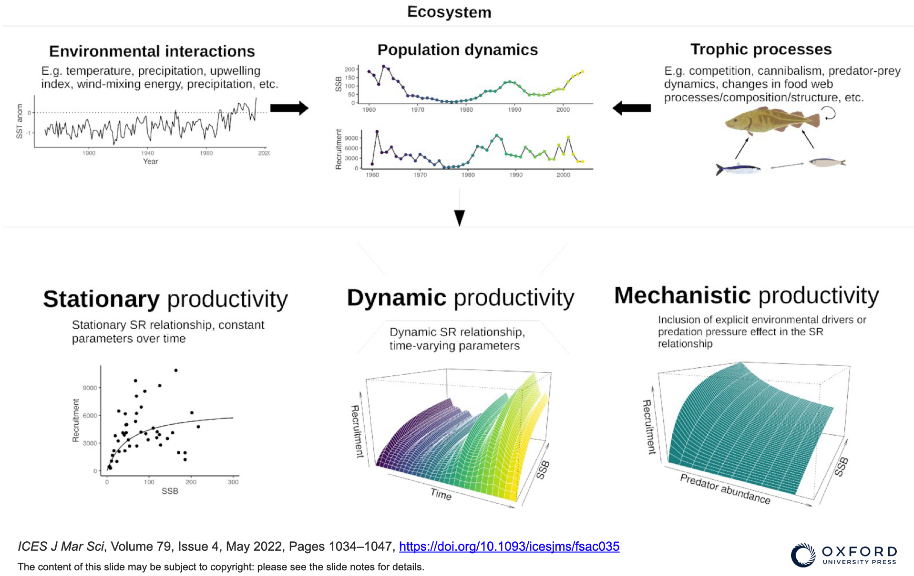
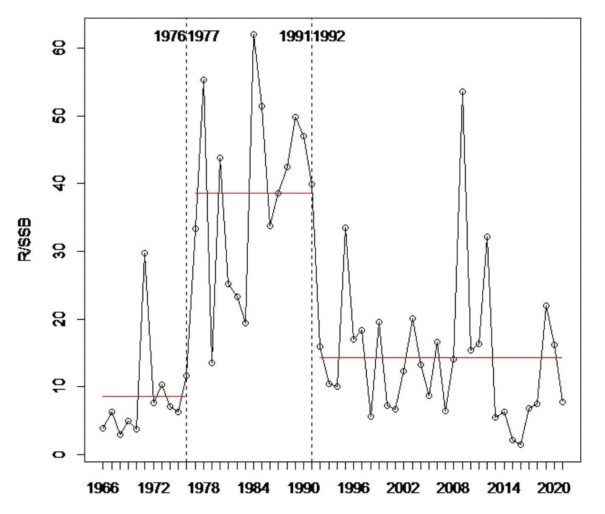
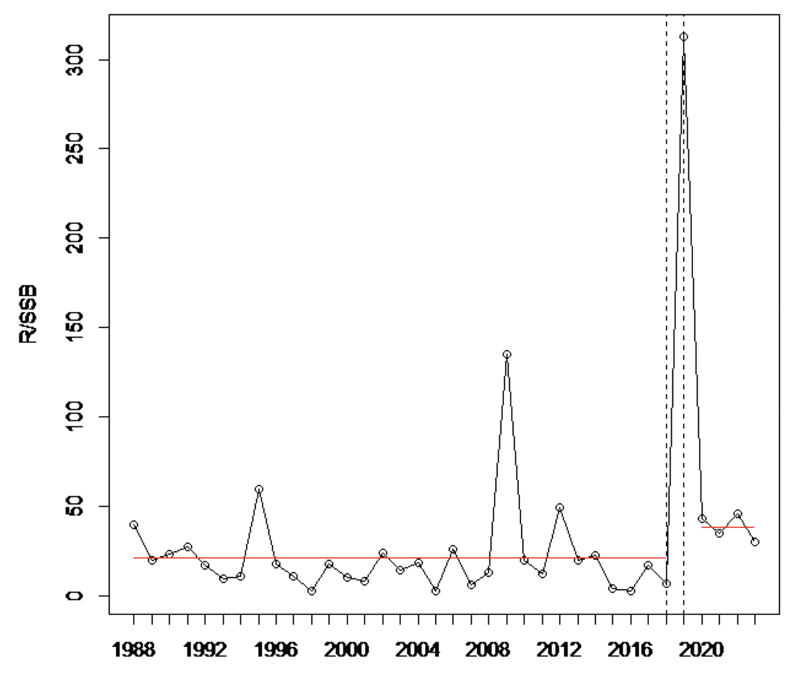
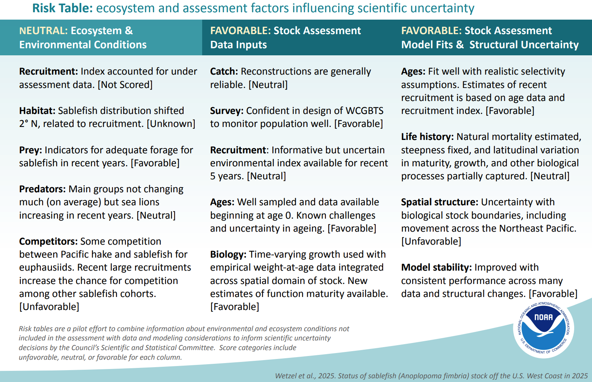

class: top, left

```{r setup, include=FALSE}

options(htmltools.dir.version = FALSE)
knitr::opts_chunk$set(echo = F,
                      fig.retina = 3,
                      warning = F,
                      message = F)
#Plotting and data libraries
library(tidyverse)
library(tidyr)
library(ggrepel)
library(here)

```


.center[
## Goal: Deliver climate and ecosystem-informed advice on fishing opportunities  
]


## Outline: 

* Options for including climate and ecosystem information advice
    1. Climate-informed reference points
    2. Qualitative risk statements in advice
    3. Quantitative catch options reflecting ecosystem drivers
    4. Long term climate projections of stock size and distribution
* Reflections on options
    1. From advice requesters
    2. From ACOM
* How to develop the advice? A tangible example


---
## Background

In early 2026, Advice Requesters, Stakeholders, and ACOM reviewed options for evolving our advice framework for fisheries to take account of ecosystem and climate change impacts. Reviewed options included:

.icesgreenbox[
Option 1: Implementation of ecosystem-informed **single-stock reference points**. 

Option 2: Inclusion of **qualitative, risk- and objectives-based statements** in advice. 

Option 3: Provision of **single, multispecies or mixed fisheries catch scenarios conditioned for** observed, anticipated, or projected **climate change or ecosystem effects**. 

Option 4: Forecast of **long-term impacts of climate change** in [fisheriesXplorer](https://ices-taf.shinyapps.io/fisheriesXplorer/). 
]

For each option, both current operational approaches and potential approaches based on scientific literature were identified.

Discussions centered on classifying each option according to utility for short term and long term management needs and alignment with current management and legal frameworks.  
---
## Option 1 Example: Dynamic Reference Points

.center[

]

.footnote[Source: Silvar-Viladomiu et al., 2022. https://academic.oup.com/icesjms/article/79/4/1034/6549169]

---
## Option 1 Example: Time Series Truncation
.pull-left[
Change point analysis: 2024 NW Atlantic herring SCAA model



]

.footnote[
Figures courtesy Jon Deroba, NOAA Northeast Fisheries Science Center
]


.pull-right[
Change point analysis: 2025 NW Atlantic herring state space model



]


---
## Option 2 Example: Stock Level Risk Statements

```{r}

Tab4 <- readr::read_csv("https://github.com/sgaichas/HSpresentations/raw/main/Conferences/BevanUW_2026-02-19/data/WestCoastRiskFramework.csv")

flextable::flextable(Tab4)|>
  flextable::set_caption("Pacific Pilot Risk Levels and Indicator Criteria.") |>
  flextable::width(width = c(4,4,4,4)) |>
  flextable::bg(i = c(1:3), bg=c("#00FF0050", "white", "#FF000050"))
```

Potential Action:  
Favorable Conditions &rarr; <span style="background-color:#00FF0050;">Decrease Risk Buffer (Higher Catch Recommendation)</span>  
Neutral Conditions &rarr; Keep Standard Risk Buffer (Standard Catch Recommendation)  
Unfavorable Conditions &rarr; <span style="background-color:#FF000050;">Increase Risk Buffer (Lower Catch Recommendation)</span>

.footnote[
Source: [CCIEA Risk Table Report](https://www.pcouncil.org/documents/2024/08/h-1-a-cciea-team-report-1-cciea-risk-table-report-on-fep-initiative-4.pdf/)
]

---
## Option 2 Example: Stock Level Risk Statements

.center[

]

.footnote[
Source: [2025 US Pacific Stock Assessment Summaries](https://www.pcouncil.org/documents/g-3-situation-summary-adopt-stock-assessments/g-3-a-supplemental-nwfsc-swfsc-report-1-2025-west-coast-groundfish-stock-assessment-at-a-glance/)
]

---
background-image: url(https://github.com/sgaichas/HSpresentations/raw/main/docs/images/Feco_Bentley.png)
background-size: 1000px
background-position: bottom 50px center

## Option 3 Example: Conditioned Catch Advice

## $F_{ECO}$

*  Stock assessment gives range of ICES Fs
*  Indicators linked to stock dynamics tested and selected
*  Current indicator status compared with previous years
*  Indicator status gives $F_{ECO}$ reference point within ICES F ranges

.footnote[Source: Bentley et al. 2021 https://www.frontiersin.org/journals/marine-science/articles/10.3389/fmars.2021.602072/full]

---
## Option 4 Example: Long-term Climate Impacts


---
## Reflections by Requesters, Stakeholders, and ACOM

Agreed that quantitative changes to headline advice (Options 1 and 3) are more effective than qualitative risk statements alone. 

Qualitative advice (Option 2) could be a useful initial step if it can lead to quantitative advice (Option 3). 

Some supported the inclusion of qualitative information for context, while others were concerned about confusion based on qualitative information alone. 

Option 4 was seen as suitable for a longer term planning horizon, if long term projection uncertainty is expressed appropriately. 

--

Technical and capacity challenges were noted with implementing any option across many or all stocks. 

Robustness of the science, accuracy of the advice, and a collaborative approach, including stakeholder engagement, were emphasized as important to success. 

ACOM:  a conceptual modeling approach could provide a basis for developing and communicating important climate and ecosystem influences on a stock, as well as for prioritizing quantitative indicator development.  

ACOM: Option 1 could include adding climate and ecosystem drivers in short term projections. Single stock reference points are updated regularly, and have been adjusted based on clear changes in stock productivity. 


---
## Moving Forward

*A structured approach combining existing ICES resources  as a prototype process for evolving FO advice*


## Example: Baltic

---
background-image: url(https://github.com/sgaichas/HSpresentations/raw/main/docs/images/ICESthankyougreen.png)
background-size: cover
background-position: center

class: middle

Slides available at https://sgaichas.github.io/HSpresentations/  
Contact: <sarah.gaichas@ices.dk>


