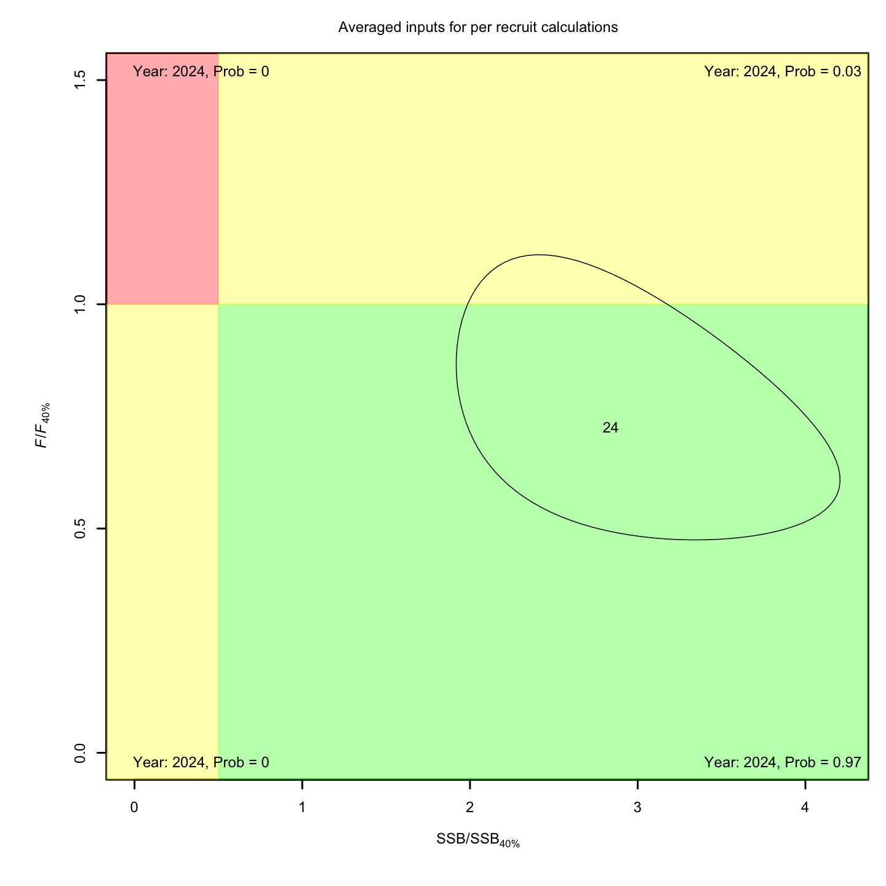
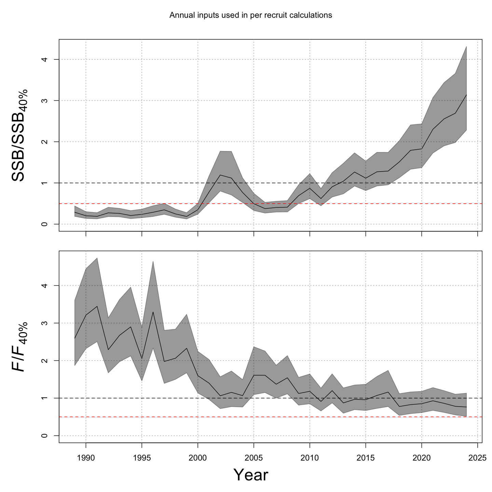
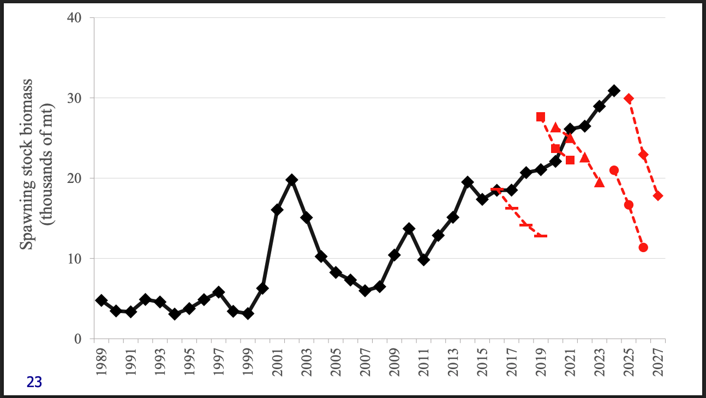
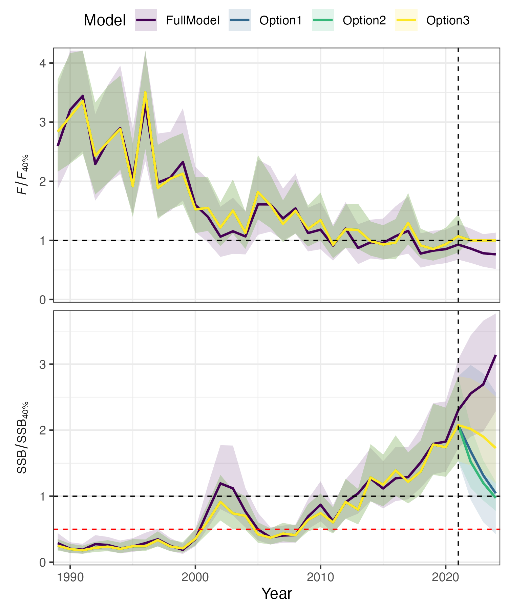

class: top, left

```{r setup, include=FALSE}

options(htmltools.dir.version = FALSE)
knitr::opts_chunk$set(echo = F,
                      fig.retina = 3,
                      warning = F,
                      message = F)
#Plotting and data libraries
library(tidyverse)
library(tidyr)
library(ggrepel)
library(here)

```

## Goal: Evaluate whether environmental covariates in assessments help with projections 

.pull-left[
## Outline
* Overview of the Black Sea Bass assessment and its environmental covariate
* Issues with the forecasts: not used for advice
* Questions
    + Can the forecast be improved with different treatment of the environmental covariate? 
    + Can we design MSE to evaluate using the environmental covariate to update previous advice rather than annually updating the full assessment?


]

.pull-right[


.footnote[Figure courtesy Kevin Friedland, NEFSC retired]

]

???
    + Includes an environmental covariate (winter bottom temperature in the northern stock area is linked to recruitment) 
    + Already used for providing management advice
    + How the covariate was selected and implemented


---
## Stock Status

The stock is not overfished and no overfishing was occurring in 2025.  
(ICES statements: Fishing pressure is below $F_{MSY}$ and the stock is above the $B_{MSY}$ target)

.pull-left[

]

.pull-right[

]

---
background-image: url(https://github.com/sgaichas/HSpresentations/raw/main/docs/images/BSB-consmod.png)
background-size:  1000px
background-position: bottom

## Known climate and/or environmental drivers 

.pull-left-70[]
.pull-right-30[
.footnote[
Source: Black Sea Bass [Ecosystem Socioeconomic Profile](https://repository.library.noaa.gov/view/noaa/66453)
See also [Miller et al. 2016 PLoS ONE](https://journals.plos.org/plosone/article?id=10.1371/journal.pone.0147627)
]
]

---
background-image: url(https://github.com/sgaichas/HSpresentations/raw/main/docs/images/BSB_Fig3Miller2025.png)
background-size:  800px
background-position: right

## The current assessment

.pull-left-30[
A multi-stock, multi-region, seasonal [Woods Hole Assessment Model (WHAM)](https://timjmiller.github.io/wham/) simultaneously models the northern and southern regions of the stock and movement of fish originating in northern region. 

Commercial and recreational fishery catch, and VAST survey and recreational CPA indices at age. Winter bottom temperature covariate on northern region recruitment.
]

.pull-right-70[
]

.footnote[
Source: [Miller et al. 2025 CJFAS](https://cdnsciencepub.com/doi/10.1139/cjfas-2025-0097) Fig. 3
]

---
## What work is proposed? 

.pull-left[



Multiple previous models with different structures turned out to have incorrect declining projections.

2025 advice for 2026-2027 applied the $F_{MSY}$ proxy to the SSB from the terminal year of the assessment, then applied the standard buffering method in the region.
]

--


.pull-right[
From the 2025 advice [recommendations](https://www.mafmc.org/s/Final_Full-SSC-Report_July-2025-SSC.pdf):

* *The SSC emphasizes a critical need for dedicated investigation of assessment model projection performance. [...] Specifically:*  
    + *How to project autocorrelated processes*  
    + *How to project environmental covariates*  
    + *Compare the performance of the terminal year OFL/ABC method used here with dynamic projections*   
* *Investigate apparent patterns in NAA random effects, can we tie to mechanisms?* 

## What advice step/component does this relate to? 

*  Forecast 
*  Management Strategy Evaluation

]
---
## How to evaluate model/forecast skill/diagnostics 

.pull-left-60[

]

.pull-right-40[

]

---
## Draft text on case study description 

---
## Available (?) Forecasts

https://www.gfdl.noaa.gov/prediction/october-2026-northwest-atlantic-predictions/

---
background-image: url(https://github.com/sgaichas/HSpresentations/raw/main/docs/images/sunrise1May2025ed.jpeg)
background-size:  100%
background-position: right

.center[
# Thanks!

# Questions?
]

.footnote[
Slides available at https://sgaichas.github.io/HSpresentations  
Contact: <sgaichas@hydrascientificllc.com>
]

