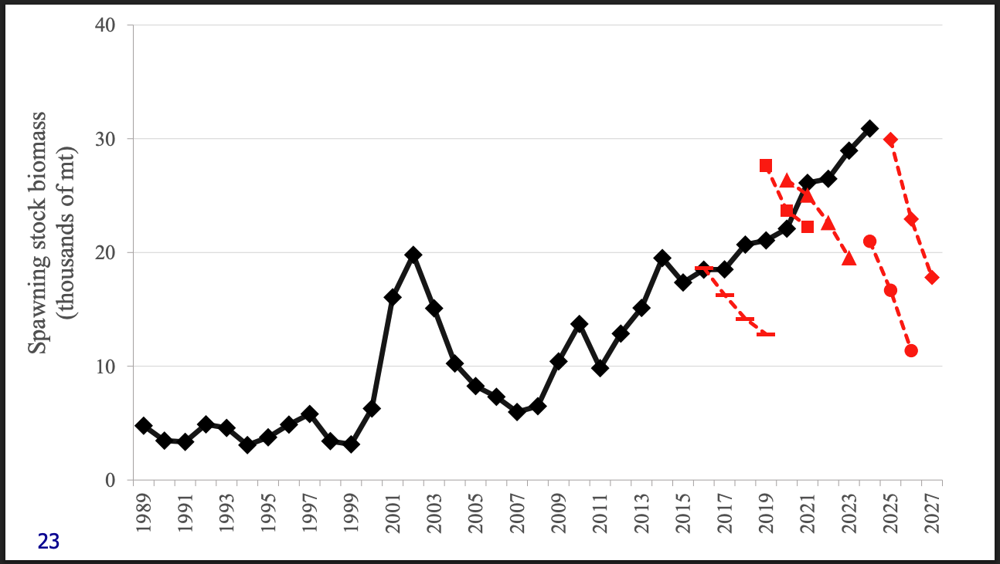
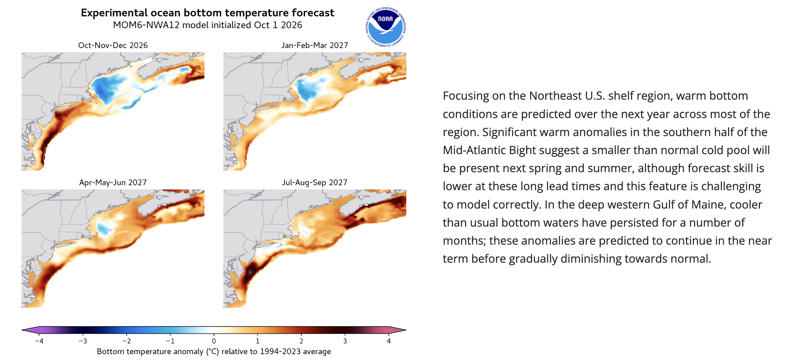

class: top, left

```{r setup, include=FALSE}

options(htmltools.dir.version = FALSE)
knitr::opts_chunk$set(echo = F,
                      fig.retina = 3,
                      warning = F,
                      message = F)
#Plotting and data libraries
library(tidyverse)
library(tidyr)
library(ggrepel)
library(here)

```

## Goal: Evaluate whether environmental covariates in assessments help with projections 

.pull-left[
## Work planned
* Forecasts: Can the forecast be improved with different treatment of the environmental covariate? 
* Covariate projections: Alternative ways to predict conditions
* MSE: Evaluate using the environmental covariate to update previous advice rather than annually updating the full assessment?


]

.pull-right[


.footnote[Figure courtesy Kevin Friedland, NEFSC retired]

]

???
    + Includes an environmental covariate (winter bottom temperature in the northern stock area is linked to recruitment) 
    + Already used for providing management advice
    + How the covariate was selected and implemented

---
## What work is proposed? 

.pull-left[



Manager perception: multiple previous models with different structures turned out to have incorrect declining projections.

2025 advice for 2026-2027 applied the $F_{MSY}$ proxy to the SSB from the terminal year of the assessment, then applied the standard buffering method in the region.
]


.pull-right[
From the 2025 advice [recommendations](https://www.mafmc.org/s/Final_Full-SSC-Report_July-2025-SSC.pdf):

* *The SSC emphasizes a critical need for dedicated investigation of assessment model projection performance. [...] Specifically:*  
    + *How to project autocorrelated processes*  
    + *How to project environmental covariates*  
    + *Compare the performance of the terminal year OFL/ABC method used here with dynamic projections*   
* *Investigate apparent patterns in NAA random effects, can we tie to mechanisms?* 

## What advice step/component does this relate to? 

*  Forecast 
*  Management Strategy Evaluation

]

???
manager perception slide doesn't correctly reflect the scale difference from those previous models before the 2023 research track, nor the uncertainty bounds around the projections that often show how the updated SSB does fall within the 95% CI.

---
background-image: url(https://github.com/sgaichas/HSpresentations/raw/main/docs/images/BSBcompare_rel_status_timeseries.png)
background-size:  460px
background-position: right 20px bottom 40px

## How to evaluate model/forecast skill/diagnostics 

.pull-left-70[
Initial effort: Emily L. dropped 3 years from the current model, projected:
*  Option 1: Continue random effects on both recruitment (R) and Numbers-at-Age (NAA)
*  Option 2: Turn off random effects on both R and NAA
*  Option 3: Average recruitment and NAA random effects over historical reference period

Next?
*  <span style="color: blue;">Use complete bottom temperature time series?</span>
*  <span style="color: blue;">Look for leading indicators of bottom temperature</span>
*  Other combinations of RE and environmental covariate? 

MSE
*  <span style="color: blue;">How to simplify the model?</span>
*  Can the environmental covariate project catch advice in the absence of an assessment?  
*  What conditions require changing previously forecast catch advice? 
*  <span style="color: blue;">Projected bottom temperature from ocean model? Other indicators?</span>
]

.pull-right-30[
]

---
background-image: url(https://github.com/sgaichas/HSpresentations/raw/main/docs/images/BSBcompare_rel_status_timeseries_BT.png)
background-size:  460px
background-position: right 20px bottom 40px

## Use true bottom temperature in forecast

.pull-left-70[
*  Did not substantially improve the forecasts 
*  Bias was very slightly reduced
]

.pull-right-30[
]
---
## Available Bottom Temperature Forecasts

For harmonization with GLORYS hindcast series, this is the bias adjustment procedure that had been suggested:

For each projection year i:

Δi = MOM6Tempi - mean(MOM6HindcastTemps)

BiasCorrectedTempi = mean(GLORYSObservedHindcastData) + Δi


.center[
<span style="color: blue;">How to harmonize with [GLORYS](https://data.marine.copernicus.eu/product/GLOBAL_MULTIYEAR_PHY_001_030/description) bottom temperature series in assessment model?</span>
]

.footnote[
Source: https://www.gfdl.noaa.gov/prediction/october-2026-northwest-atlantic-predictions/
]

???


---
## Andi got further than I did--passing off to her

---
background-image: url(https://github.com/sgaichas/HSpresentations/raw/main/docs/images/sunrise1May2025ed.jpeg)
background-size:  100%
background-position: right

.center[
# Thanks!

# Questions?
]

.footnote[
Slides available at https://sgaichas.github.io/HSpresentations  
Contact: <sgaichas@hydrascientificllc.com>
]

